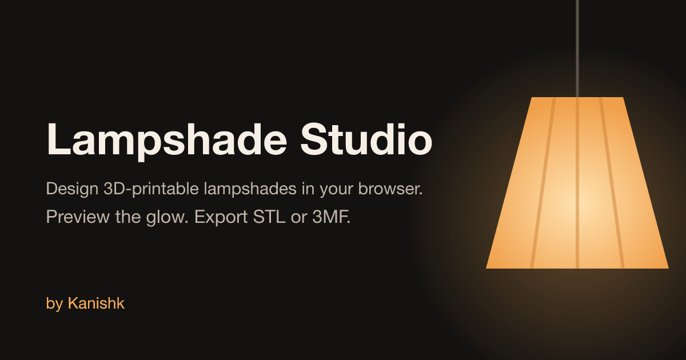

# Lampshade Studio



Design 3D-printable lampshades in your browser. No account needed.

**Live:** https://lampshade-studio.vercel.app

## What it does
- **Shape:** start from Blank or a preset, then drag profile points or type exact heights and diameters.
- **Surface:** sides, twist, ripples, vertical waves, and perforations (circle, slot, diamond), cut with [manifold-3d](https://github.com/elalish/manifold).
- **Finish:** filament colour, matte/silk/glossy, bulb brightness and colour temperature. The lit view simulates light passing through the wall.
- **Print:** solid or vase mode, E27/E14 fitting (fused spider or glue-in ring), printer bed check, overhang heatmap, filament estimate.
- **Export:** 3MF or STL. Watertight meshes. Share a design with a link, or save it in your browser.

## Run locally
```bash
npm install
npm run dev
```

Built with React, three.js, [HeroUI](https://heroui.com) and Vite.

Made by [Kanishk](https://github.com/kanishksingh3012).
